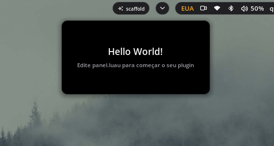

# Noctalia Scaffold

Starting a Noctalia v5 plugin means rebuilding a Luau test harness and finding conventions scattered across other plugins. Copying a working plugin also brings its unrelated business logic. This repository gives plugin authors a small, tested starting point: a Hello World plugin, a generator and a styleguide.

## Try the example

The bar shows a glyph and the configurable `scaffold` label. Clicking opens a dropdown panel with `Hello World!` and a translated subtitle. Vertical bars show only the glyph. A blank label falls back to the default.



## Start a plugin

Requires Bash, Git, GNU tar, GNU sed and the `luau` CLI on PATH.

```bash
./scaffold new my-plugin --dir ..
cd ../my-plugin
./run-tests
```

The new plugin id is `$(whoami)/my-plugin`: the author prefix defaults to your machine user name (`whoami`). Pass `--author <github-user>` when your published id should differ.

On GitHub, choose **Use this template**, clone the result, then run `./scaffold new` to apply a new identity. A GitHub template copy alone keeps the example identity.

To refresh an existing plugin's harness:

```bash
./scaffold sync ../my-plugin
```

This replaces `tests/support/`, `run-tests` and the CI workflow while preserving plugin code and test suites.

## Install locally

From a plugin created with `./scaffold new my-plugin`:

```bash
mkdir -p ~/.local/share/noctalia/plugins
ln -s "$PWD" ~/.local/share/noctalia/plugins/my-plugin
echo "$(whoami)/my-plugin"   # the id to use below
```

Add that id to `[plugins] enabled` in `plugins.toml`. In `bar.toml`, add `my-plugin` to a bar slot and define (replace `<whoami>` with the output above):

```toml
[widget.my-plugin]
type = "<whoami>/my-plugin:bar"
```

If the panel looks see-through, your bar is translucent: attached panels inherit its opacity. Float it instead (see [Panels](docs/STYLEGUIDE.md#panels)).

Restart Noctalia. GUI settings may override entire enabled and bar-slot lists; check the effective configuration with `noctalia config export`.

## Tests

```bash
./run-tests
shellcheck scaffold run-tests tests/*.test.sh
```

The runner checks the manifest, pure presentation models, entries, locale key parity, generator and docs. It also verifies that a deliberately failing fixture is detected. CI installs the pinned Luau CLI and runs the same suite.

## Repository scope

The plugin and generator share the same harness, manifest and entry scripts so generated plugins start with the tested example. Read [the styleguide](docs/STYLEGUIDE.md) for conventions. `CLAUDE.md` provides instructions for AI coding agents; humans start with this README and the styleguide.

## Security

The plugin makes no network calls, executes no commands and reads or writes no files. It reads its label through the host settings API. The generator writes inside its selected target directory: `new` creates a fresh repository; `sync` replaces only harness paths and adds the generated-files ignore entry. Review the target before syncing because custom support files are replaced. The test harness compiles local Luau source; run tests only for code you trust. CI downloads Luau from its upstream GitHub release.

## License

MIT, Fernando Moreira Costa.
